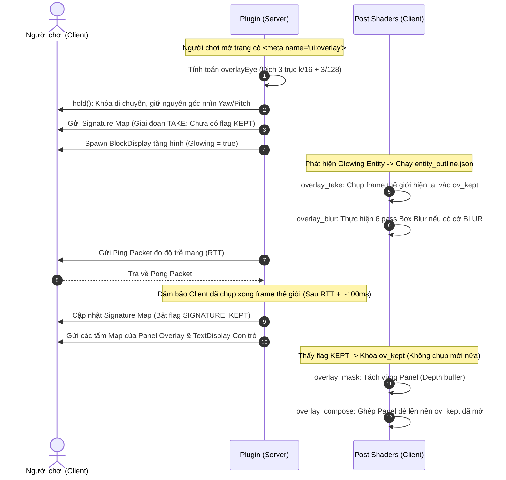

# Luồng Hoạt Động Của Plugin Trong Việc Hiển Thị GUI (Fullscreen & Overlay/Blur)

Tài liệu này phân tích chi tiết cơ chế hoạt động bên trong của plugin **MC GUI / UI Engine**, giải thích cách plugin hiển thị giao diện đồ họa (GUI) ở hai chế độ: **Fullscreen (Toàn màn hình)** và **Overlay / Blur (Lớp phủ bán trong suốt & làm mờ nền thế giới)**.

---

## 1. Tổng quan Kiến Trúc: Đột Phá Kỹ Thuật (Zero-Client-Mod)

Thông thường, để hiển thị giao diện HTML/CSS mượt mà, hỗ trợ chuột 60+ FPS, nền mờ và trong suốt trong Minecraft, người ta bắt buộc phải cài đặt Mod phía Client (như Fabric/Forge mod). 

Tuy nhiên, plugin này hoạt động theo cơ chế **100% Vanilla Client**:
- **Server:** Chạy trên nền tảng Paper/Spigot (1.21.11+). Server dựng layout HTML/CSS thành các tấm ảnh bitmap (Java2D/Canvas), chia nhỏ thành các Map trong Item Frame, và điều khiển các entity ảo.
- **Client:** Sử dụng **Resource Pack** tùy chỉnh chứa các **Core Shaders** (`text.vsh`, `text.fsh`, `position_tex_color.vsh`) và chuỗi **Post-processing Shaders** (`entity_outline.json`, `blur.json`, `transparency.json`).

### Bí mật cốt lõi: Tọa độ Camera Đánh Dấu (Flagged Camera Offset)
Làm thế nào Shaders ở Client biết được người chơi đang mở GUI để kéo giãn bản đồ hay kích hoạt hiệu ứng làm mờ mà không cần gửi bất kỳ custom packet nào?
- Minecraft Client luôn nạp tọa độ camera hiện tại của người chơi vào uniform `Globals.CameraOffset` trong shader.
- Server cố ý dịch chuyển vị trí mắt/camera của người chơi theo một phân số đặc biệt:
  $$\text{Tọa độ} = \frac{k}{16} + \frac{3}{128} \quad (\approx k \times 0.0625 + 0.0234375)$$
  (Được định nghĩa trong mã nguồn là `FLAG_STEP = 1.0 / 16` và `FLAG_PHASE = 3.0 / 128`).
- **Fullscreen:** Chỉ có **1 trục ngang** (trục X hoặc Z) bị dịch theo công thức này, 2 trục còn lại nằm trên lưới `0` hoặc `0.5` block (`mcb_flag_axis() = 0 hoặc 2`).
- **Overlay:** Cả **3 trục (X, Y, Z)** đều bị dịch theo công thức này (`mcb_flag_axis() = 1`). Mắt người chơi chỉ bị dịch tối đa $1/32$ block so với vị trí thực tế, người chơi hoàn toàn không cảm nhận được sự thay đổi vị trí.
- Trong GLSL Shader, hàm `mcb_seated_flag()` kiểm tra `CameraOffset`: Nếu phát hiện tọa độ khớp với cờ đánh dấu này, shader sẽ chuyển sang chế độ GUI!

---

## 2. Dạng 1: Chế Độ Fullscreen (Toàn Màn Hình)

Chế độ Fullscreen biến toàn bộ màn hình của người chơi thành một trang web/ứng dụng, che kín thế giới trò chơi.

```
+-------------------------------------------------------------------+
|                        MÀN HÌNH FULLSCREEN                        |
|                                                                   |
|         [Header / Logo / Navigation]                              |
|                                                                   |
|         +-----------------------------------------------+         |
|         |                                               |         |
|         |           NỘI DUNG GIAO DIỆN (HTML)           |         |
|         |                                               |         |
|         |                      +--------+               |         |
|         |                      | Button |   <-- [Pointer]         |
|         |                      +--------+               |         |
|         +-----------------------------------------------+         |
|                                                                   |
+-------------------------------------------------------------------+
```

### A. Phía Server Xử Lý Những Gì?

1. **Dựng giao diện (Painting & Map Slicing):**
   - Đọc tệp HTML/CSS, bố cục layout và vẽ giao diện lên bề mặt đồ họa bằng Java2D (`HtmlRenderer`, `Painter`). Quá trình vẽ được chia làm 4 luồng song song (`paintBands`) để tối đa hóa hiệu năng.
   - Bức ảnh hoàn chỉnh được chuyển đổi sang bảng màu Minecraft Map (`Palette`) và chia thành lưới các Map 128x128 pixels (ví dụ: giao diện 1920x1080 cần khoảng 16x9 = 144 bản đồ).
   - Mã hóa metadata (cột, hàng, kích thước view) vào các pixel đặc biệt (symbols) ở mép bản đồ.

2. **Khởi tạo môi trường hiển thị (`Views.open`):**
   - **Treo bản đồ (`MapWall.Stack.at(cam)`):** Server sinh ra các Item Frame chứa Map treo ngay tại block của camera người chơi.
   - **Entity tương tác (`Interaction`):** Spawn một entity Interaction tàng hình ngay trước mặt người chơi (`CLIENT_TARGET = 0.02f`) để đón nhận mọi cú click chuột trái / chuột phải.
   - **Con trỏ chuột (`TextDisplay`):** 
     - Spawn một TextDisplay hiển thị ký tự con trỏ chuột.
     - Đặt màu Text với kênh Red đặc biệt: `CLIENT_POINTER_RED = 253` (với client-pointer) hoặc `POINTER_RED = 254` (với server-pointer). Kênh Green và Blue chứa số cột và số hàng của view.
     - Đặt khoảng cách của TextDisplay theo công thức: `distance = 0.5 + speed / 512`. Shader ở Client sẽ đọc khoảng cách này để biết tốc độ di chuột của người chơi.

3. **Cố định người chơi (`Views.hold`):**
   - Để ngăn người chơi di chuyển làm hỏng góc nhìn:
     - Gửi packet gán trạng thái **Bay giả lập** (`flying = true`, `flying_speed = 0`, `walking_speed = 0`). Việc này ngăn người chơi bị trượt chân, rơi tự do, hoặc crouching (crouch sẽ làm hạ thấp chiều cao mắt).
     - Áp dụng các `AttributeModifier`: `MOVEMENT_SPEED = 0`, `JUMP_STRENGTH = 0`, `GRAVITY = 0`, `KNOCKBACK_RESISTANCE = 1`.
     - Chuyển Gamemode sang `ADVENTURE`.
     - Làm trống hotbar qua packet (`pipeline.conceal`) để khi lăn chuột không bị hiện popup tên item.
     - Ẩn cánh tay thứ nhất (`PotionEffectType.INVISIBILITY` hoặc packet invisibility).
     - Đặt thời tiết cá nhân thành trời quang (`WeatherType.CLEAR`) để hạt mưa/tuyết không chắn trước màn hình.

4. **Bắt Input và Tương Tác:**
   - Đọc packet gói tin chuột (Yaw/Pitch) từ Netty pipeline (`Pipeline.watch`).
   - Chuyển đổi góc quay camera thành tọa độ pixel trên Canvas HTML.
   - Xử lý Hover, Active, Click, Scroll, TextInput và gửi các phần bản đồ bị thay đổi (partial repaint) tới client qua `MapSender`.

---

### B. Phía Client (Resource Pack & Shaders) Xử Lý Những Gì?

1. **Ẩn hoàn toàn giao diện mặc định (`position_tex_color.vsh`):**
   - Shader kiểm tra `CameraOffset`: Khi phát hiện cờ Seated (`mcb_seated_flag() > 0.5`), shader gán `vertexColor.a = 0.0` cho toàn bộ các quad vẽ HUD (thanh máu, giáp, thanh thức ăn, hotbar, tâm ngắm crosshair, viền tối vignette, hiệu ứng lửa/dưới nước).
   - Fragment shader của Minecraft tự động loại bỏ các pixel có `alpha = 0` (`discard`), khiến HUD biến mất sạch sẽ.

2. **Kéo giãn Bản đồ 3D thành 2D Fullscreen (`text.vsh` & `text.fsh`):**
   - Minecraft hiển thị Item Frame Maps thông qua **Text Render Pipeline**.
   - Trong `text.vsh`, hàm `mcb_locate()` quét và nhận diện các tấm Map thuộc UI Engine (`mcbMap == 3`).
   - Shader đọc ký hiệu cột, hàng từ texture của Map (`mcbTile` và `mcbViewGrid`).
   - Hàm `mcb_flat()` thực hiện phép biến đổi hình học quan trọng nhất:
     ```glsl
     vec2 mcbAt = (mcbTile + mcbUv) / mcbViewGrid;
     gl_Position = mcb_flat(vec2(mcbAt.x * 2.0 - 1.0, 1.0 - mcbAt.y * 2.0));
     ```
     Phép tính này ánh xạ trực tiếp các góc của quad 3D trong thế giới thành **Tọa độ Thiết bị Chuẩn hóa 2D (Normalized Device Coordinates - NDC)** từ `[-1, -1]` đến `[1, 1]`.
   - Toàn bộ các tấm Map được ghép lại liền mạch và kéo giãn lấp đầy 100% cửa sổ game, bất kể FOV hay độ phân giải màn hình của người chơi.

3. **Render Con Trỏ Chuột Siêu Mượt (Client-Side Prediction):**
   - Nhờ TextDisplay mang màu Red = 253, hàm `mcb_client_pointer()` trong `text.vsh` nhận diện đây là con trỏ chuột.
   - Shader đọc trực tiếp ma trận xoay góc nhìn `ModelViewMat` của camera trong khung hình hiện tại:
     ```glsl
     vec2 hot = mcb_hot(size, ahead, speed, hint);
     ```
   - Con trỏ chuột được vẽ lại tại vị trí mới **ngay lập tức theo từng frame render của client** (lên đến 144Hz, 240Hz+) mà không cần chờ gói tin phản hồi từ server, loại bỏ 100% cảm giác giật/lag chuột.

---

## 3. Dạng 2: Chế Độ Overlay & Blur (Lớp Phủ Bán Trong Suốt & Làm Mờ Nền)

Chế độ Overlay xuất hiện khi tệp HTML có thẻ khai báo:
```html
<meta name="ui:overlay" content="rgba(10, 15, 30, 0.4) blur">
```
Trong chế độ này, panel giao diện chỉ chiếm một phần màn hình ở giữa. Xung quanh panel là thế giới Minecraft thực tế nơi người chơi đang đứng, nhưng thế giới này bị **đóng băng (freeze)** và **làm mờ (blur)**, kèm một lớp màu phủ (`tint`).

```
+-------------------------------------------------------------------+
|               THẾ GIỚI 3D PHÍA SAU ĐÃ BỊ ĐÓNG BĂNG & BLUR         |
|                                                                   |
|             +---------------------------------------+             |
|             |          PANEL OVERLAY (HTML)         |             |
|             |                                       |             |
|   (MỜ)      |    [Thông báo / Menu / Popup]         |    (MỜ)     |
|             |                                       |             |
|             |          [ ĐỒNG Ý ]   [ HỦY ]   <--+  |             |
|             |                                    |  |             |
|             +------------------------------------|--+             |
|                                                  |                |
|                                             [Pointer]             |
+-------------------------------------------------------------------+
```

### Thách thức kỹ thuật lớn nhất:
Khi người chơi di chuyển chuột để điều khiển con trỏ trên panel Overlay, camera thật của người chơi trong game cũng xoay theo. Nếu thế giới phía sau vẫn render trực tiếp, **thế giới 3D xung quanh panel sẽ xoay mòng mòng theo chuyển động chuột**, gây chóng mặt cực độ!

**Giải pháp độc quyền của UI Engine:**
Sử dụng chuỗi **Post-processing Shader (`entity_outline.json`)** với bộ đệm vĩnh cửu (`persistent target: ov_kept`) để **chụp lại (Take)** khung hình thế giới tại thời điểm mở menu, **làm mờ 6 lần**, sau đó **đóng băng (Keep)** khung hình đó cố định xung quanh panel bất kể camera xoay đi đâu.

---

### A. Phía Server Xử Lý: Quy Trình 2 Giai Đoạn (Take & Keep)

Server thực hiện một quy trình đồng bộ chặt chẽ gồm 2 bước:



#### Chi tiết các bước Server xử lý:

1. **Tính toán vị trí mắt (`Views.overlayEye`):**
   - Khác với Fullscreen dịch chuyển người chơi đến vị trí cố định, Overlay tìm vị trí gần nhất quanh mắt người chơi sao cho cả 3 tọa độ (X, Y, Z) đều thỏa mãn phân số `k/16 + 3/128`.
   - Độ lệch tối đa không quá $1/32$ block. Góc nhìn Yaw và Pitch được giữ nguyên 100% để hình ảnh không bị giật.

2. **Kích hoạt công tắc Shader (Glowing Switch):**
   - Post-effect shader `entity_outline.json` của Minecraft bình thường **chỉ chạy khi có entity phát sáng (Glowing)**.
   - Để ép shader này luôn luôn chạy, Server spawn một `BlockDisplay` vô hình siêu nhỏ (`scale = 0.001f`) ngay tại vị trí mắt người chơi và bật `setGlowing(true)`.
   - Display này hoàn toàn vô hình, nhưng làm "công tắc" kích hoạt toàn bộ chuỗi shader xử lý ảnh phía sau.

3. **Giai đoạn 1 - Chụp ảnh thế giới (`Views.take`):**
   - Server gửi một tấm bản đồ đặc biệt gọi là **Signature Map** (`Palette.markSignature`).
   - Signature Map này mang các cờ: `SIGNATURE_BLUR` (nếu trang yêu cầu làm mờ), nhưng **chưa có cờ `SIGNATURE_KEPT`**.
   - Server gửi kèm một Ping packet và theo dõi phản hồi qua `pipeline.afterClientCaughtUp`.

4. **Giai đoạn 2 - Khóa ảnh thế giới (`Views.keep`):**
   - Khi client đã gửi lại Pong (chứng minh client đã render ít nhất 1 frame thế giới hoàn chỉnh cùng Signature Map) và sau một khoảng thời gian an toàn (`KEEP_AFTER_NANOS = 100ms`):
   - Server cập nhật Signature Map với cờ **`SIGNATURE_KEPT`**.
   - Server gửi các map tile chứa nội dung của Panel HTML và hiển thị TextDisplay con trỏ chuột.
   - Xoay nhẹ hướng nhìn người chơi về tâm panel để bắt đầu điều khiển con trỏ.

---

### B. Phía Client (Resource Pack Shaders) Xử Lý

Toàn bộ ma thuật của Overlay diễn ra trong các file GLSL Shader:

#### 1. Đọc tín hiệu từ Server (`text.fsh` & `OVERLAY_SIGNATURE`):
- `text.fsh` vẽ Signature Map lên **4 pixel tại góc dưới cùng bên trái màn hình** (từ tọa độ `(0,0)` đến `(3,0)`).
- 4 pixel này chứa:
  - Pixel 0: Mã nhận diện cố định `0x5AC396`.
  - Pixel 1: Màu sắc lớp phủ `tint` (RGB).
  - Pixel 2: Độ trong suốt `tint alpha` và các cờ (`BLUR`, `KEPT`, `REVERSED_DEPTH`).
  - Pixel 3: Mã kết thúc `0x69`.
- Shaders đọc 4 pixel này qua hàm `ov_signature()` để biết chính xác cần phải làm gì.

#### 2. Chụp và Làm mờ 6 Lần (`keepPasses` trong `Shaders.java`):
Chuỗi shader định nghĩa một target đặc biệt trong `entity_outline.json`:
```json
"targets": {
  "swap": {}, "ov_a": {}, "ov_b": {}, 
  "ov_kept": { "persistent": true }
}
```
> **Lưu ý:** Thuộc tính `"persistent": true` đảm bảo rằng buffer `ov_kept` trong bộ nhớ GPU sẽ không bị xóa trắng giữa các frame render!

- **Khi chưa có cờ `SIGNATURE_KEPT` (Giai đoạn Take):**
  - Pass 1 (`overlay_take.fsh`): Đọc hình ảnh thế giới hiện tại từ buffer `minecraft:main`, thực hiện bước làm mờ ngang đầu tiên, lưu vào `ov_a`.
  - Pass 2 đến 6 (`overlay_blur.fsh`): Luân phiên làm mờ dọc và ngang giữa `ov_a` và `ov_b`.
    - Lặp lại **3 vòng Box Blur** (3 lần ngang, 3 lần dọc).
    - Bán kính làm mờ lấy trực tiếp từ uniform `MenuBlurRadius` trong cài đặt video của người chơi.
  - Pass 6 lưu kết quả cuối cùng vào **`ov_kept`**.

- **Khi cờ `SIGNATURE_KEPT` được bật (Giai đoạn Keep):**
  - Shader `overlay_take` và `overlay_blur` thấy cờ `KEPT` lập tức dừng hoạt động (`discard`).
  - Hình ảnh trong `ov_kept` được **đóng băng nguyên vẹn**! Dù người chơi có xoay camera thế nào ở các frame tiếp theo, `ov_kept` vẫn giữ nguyên bức tranh tĩnh lúc mở menu.

#### 3. Tách lớp và Ghép ảnh (`overlay_mask.fsh` & `overlay_compose.fsh`):
- **Tách lớp (`overlay_mask.fsh`):**
  - Shader đọc Depth Buffer của game (`MainDepthSampler`).
  - Vì các tấm Map của panel và con trỏ chuột được vẽ rất gần camera (độ sâu cực nhỏ: $z < 0.00005$), shader dễ dàng phân biệt đâu là pixel của UI và đâu là pixel của thế giới 3D phía sau.
  - Vùng UI được đánh dấu `alpha = 1.0`, vùng thế giới được đánh dấu `alpha = 0.0`.
- **Ghép ảnh (`overlay_compose.fsh`):**
  - Nếu pixel thuộc về Panel UI (`alpha > 0.5`): Giữ nguyên màu của Panel.
  - Nếu pixel thuộc về nền: Lấy màu từ khung hình tĩnh đã đóng băng trong `ov_kept`, sau đó hòa trộn thêm màu phủ `tint` (ví dụ màu tối mờ `rgba(0, 0, 0, 0.4)`).
  - 4 pixel tín hiệu ở góc màn hình được vẽ đè lại bằng màu của pixel ngay phía trên nó, **xóa sạch mọi dấu vết kỹ thuật**, trả lại màn hình đẹp không tì vết!

---

## 4. Bảng So Sánh Tổng Hợp Giữa Hai Chế Độ

| Đặc điểm | Fullscreen Mode (Toàn màn hình) | Overlay / Blur Mode (Lớp phủ & Mờ) |
| :--- | :--- | :--- |
| **Khai báo HTML** | Trang HTML thông thường | Thẻ `<meta name="ui:overlay" content="... blur">` |
| **Phạm vi hiển thị** | Che kín toàn bộ màn hình 100% | Panel hiển thị ở giữa, thấy thế giới xung quanh |
| **Thế giới phía sau** | Bị che khuất hoàn toàn | Bị đóng băng (Freeze frame) và làm mờ (Box Blur) |
| **Vị trí mắt Player** | Chuyển đến vị trí cố định (`clientEye`) | Giữ nguyên tại chỗ, dịch $\le 1/32$ block (`overlayEye`) |
| **Cờ Camera Shaders** | 1 trục ngang thỏa mãn $k/16 + 3/128$ | Cả 3 trục (X, Y, Z) thỏa mãn $k/16 + 3/128$ |
| **Shader can thiệp** | `text.vsh`, `text.fsh`, `position_tex_color` | Thêm chuỗi Post-effects: `entity_outline.json` |
| **Cơ chế kích hoạt** | Cờ tọa độ camera (`CameraOffset`) | Tọa độ camera + `BlockDisplay` tàng hình Glowing |
| **Giao tiếp tín hiệu** | Qua thuộc tính Text Display & Symbols | Qua **Signature Map** (4 pixel góc màn hình) |
| **Độ mượt con trỏ** | 60+ FPS (Client-side prediction) | 60+ FPS (Client-side prediction) |

---

## 5. Những Lưu Ý Quan Trọng Cho Người Fork Mã Nguồn

Nếu bạn đã fork kho lưu trữ này về và muốn tùy chỉnh hoặc tích hợp vào server:

1. **Yêu cầu phiên bản Minecraft Client & Server:**
   - Phiên bản tối thiểu được hỗ trợ là **Minecraft 1.21.11**.
   - Các bản 1.21.9 và 1.21.10 không có uniform `CameraOffset` trong `Globals.glsl` của client, do đó shader không thể nhận diện người chơi đang seated/overlay.
   - Từ bản 26.3 trở đi, Minecraft chuyển sang chuẩn shader Vulkan GLSL mới (`layout(location = N)`), plugin đã viết sẵn bộ sinh tự động (`Shaders.to262`) để tạo tương thích chéo giữa 1.21.11, 26.1, 26.2 và 26.3.

2. **Xung đột Shader Pack (Iris / OptiFine):**
   - Nếu client cài đặt Iris Shaders hoặc OptiFine và bật shader pack bên ngoài (SEUS, BSL, Complementary...), các shader pack này sẽ thay thế toàn bộ pipeline vẽ Map và Text của Minecraft.
   - Khi đó, các shader của UI Engine sẽ không chạy được, người chơi sẽ nhìn thấy một thông báo lỗi màu vàng cam (`NOTICE_RGB = 0xFCE04A`) lơ lửng trước mặt giải thích nguyên nhân.

3. **Gộp Resource Pack với các plugin khác (ItemsAdder, Oraxen, Nexo, BetterHud):**
   - Trong thư mục `ai.resourcepack.ui.framework.pack`, plugin có sẵn hệ thống **`ForeignShaders`** và **`MergeCheck`**.
   - Khi khởi động, plugin sẽ tự động quét thư mục của các plugin khác để gộp (merge) mã GLSL của `text.vsh`/`text.fsh` vào pack của ItemsAdder/Oraxen mà không làm mất tính năng của cả hai bên.
